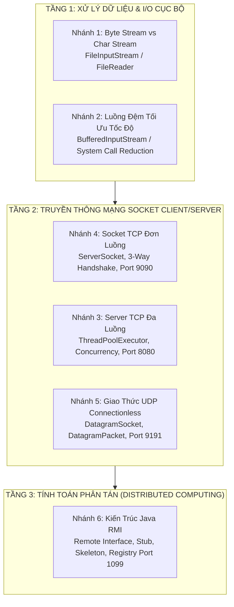

# CẨM NANG TỔNG HỢP KIẾN THỨC VÀ BỘ CÂU HỎI VẤN ĐÁP BÁO CÁO CUỐI KỲ
## HỌC PHẦN: LẬP TRÌNH MẠNG MÁY TÍNH (NETWORK PROGRAMMING)

> **Dự án:** Báo Cáo Cuối Kỳ Thực Nghiệm Đa Nhánh (`LT_MMT_BaoCaoCK`)  
> **Ngôn ngữ & Nền tảng:** Java SE (JDK 8+), Java Swing UI, NetBeans GUI Builder  
> **Mục tiêu tài liệu:** Tổng hợp toàn diện lý thuyết nền tảng Mạng Máy Tính, kiến trúc hệ thống 6 nhánh thực nghiệm, ma trận so sánh liên nhánh và bộ câu hỏi vấn đáp cốt lõi phục vụ bảo vệ đồ án trước Hội đồng.

---

## MỤC LỤC TỔNG QUAN

1. [Bản Đồ Kiến Trúc Hệ Thống & 6 Nhánh Thực Nghiệm](#1-bản-đồ-kiến-trúc-hệ-thống--6-nhánh-thực-nghiệm)
2. [Lý Thuyết Cốt Lõi Về Mạng Máy Tính & Hệ Điều Hành](#2-lý-thuyết-cốt-lõi-về-mạng-máy-tính--hệ-điều-hành)
   - 2.1. Mô hình OSI 7 tầng vs Mô hình TCP/IP 4 tầng
   - 2.2. Khái niệm Socket, Cổng (Port) và Địa chỉ IP
   - 2.3. Cơ chế I/O, Bộ nhớ đệm và Tương tác User Space / Kernel Space
   - 2.4. Đa luồng (Multithreading) & Cơ chế ThreadPool trong Lập trình Mạng
   - 2.5. Lập trình tính toán phân tán: RMI (Remote Method Invocation)
   - 2.6. Nguyên lý Event Dispatch Thread (EDT) và SwingWorker trong ứng dụng GUI
3. [Bảng Ma Trận So Sánh Liên Nhánh](#3-bảng-ma-trận-so-sánh-liên-nhánh)
   - 3.1. Byte Stream vs Character Stream
   - 3.2. Unbuffered Stream vs Buffered Stream
   - 3.3. Giao thức TCP vs Giao thức UDP
   - 3.4. Lập trình Socket TCP truyền thống vs Java RMI
4. [Bộ Câu Hỏi Vấn Đáp Tổng Quát & Đáp Án Mẫu Xuất Sắc](#4-bộ-câu-hỏi-vấn-đáp-tổng-quát--đáp-án-mẫu-xuất-sắc)
5. [Kịch Bản Thuyết Minh & Trả Lời Vấn Đáp Điểm Tối Đa](#5-kịch-bản-thuyết-minh--trả-lời-vấn-đáp-điểm-tối-đa)
6. [Liên Kết Tài Liệu Chuyên Sâu Từng Nhánh](#6-liên-kết-tài-liệu-chuyên-sâu-từng-nhánh)

---

## 1. BẢN ĐỒ KIẾN TRÚC HỆ THỐNG & 6 NHÁNH THỰC NGHIỆM

Dự án được cấu trúc theo tiến trình từ **Nền tảng I/O cục bộ trên một máy** đến **Truyền thông Socket mạng Client/Server**, và nâng cao thành **Hệ thống phân tán triệu gọi phương thức từ xa (RMI)**:



### Bảng tóm tắt nhiệm vụ và cổng giao tiếp của 6 nhánh:

| Nhánh | Package | Chủ đề kỹ thuật | Cổng / Dịch vụ | Lớp cốt lõi | Giao diện GUI |
| :--- | :--- | :--- | :--- | :--- | :--- |
| **1** | `nhanh1` | Luồng Byte vs Luồng Ký tự | File I/O | `ByteStreamDemo`, `CharStreamDemo`, `PerformanceComparator` | `MainForm` |
| **2** | `nhanh2` | Kỹ thuật Luồng đệm (Buffered Stream) | File I/O | `UnbufferedCopy`, `BufferedCopy`, `BenchmarkRunner` | `BenchmarkForm` |
| **3** | `nhanh3` | Server TCP Đa luồng (ThreadPool) | TCP `8080` | `MultiThreadedServer`, `ClientHandler`, `TestClient` | `ServerForm`, `ClientForm` |
| **4** | `nhanh4` | Socket TCP Client/Server cơ bản | TCP `9090` | `TCPServer`, `TCPClient`, `TCPServerListener` | `ServerForm`, `ClientForm` |
| **5** | `nhanh5` | Truyền nhận dữ liệu không kết nối UDP | UDP `9191` | `UDPServer`, `UDPClient`, `UDPServerListener` | `ServerForm`, `ClientForm` |
| **6** | `nhanh6` | Gọi phương thức từ xa (Java RMI) | RMI `1099` | `HelloInterface`, `HelloImpl`, `RMIServer`, `RMIClient` | `ServerForm`, `ClientForm` |

---

## 2. LÝ THUYẾT CỐT LÕI VỀ MẠNG MÁY TÍNH & HỆ ĐIỀU HÀNH

### 2.1. Mô hình OSI 7 tầng vs Mô hình TCP/IP 4 tầng

Khi truyền dữ liệu qua mạng, thông tin đi từ tầng ứng dụng xuống tầng vật lý ở bên gửi (quá trình **Encapsulation - Đóng gói dữ liệu**) và đi ngược từ tầng vật lý lên tầng ứng dụng ở bên nhận (quá trình **Decapsulation - Mở gói dữ liệu**).

```
   Mô hình OSI (7 tầng)               Mô hình TCP/IP (4 tầng)         Công nghệ áp dụng trong Project
+---------------------------+       +-------------------------+       +-------------------------------+
| 7. Application (Ứng dụng) | ----\ |                         | ----> | RMI (JRMP), Custom Protocol   |
| 6. Presentation (Trình bày)| ----> | 4. Application (Ứng dụng)| ----> | Java Charset (UTF-8, Unicode) |
| 5. Session (Phiên)        | ----/ |                         | ----> | Socket Connection Session     |
+---------------------------+       +-------------------------+       +-------------------------------+
| 4. Transport (Giao vận)   | ----> | 3. Transport (Giao vận) | ----> | TCP (Nhánh 3,4,6) / UDP (Nh. 5)|
+---------------------------+       +-------------------------+       +-------------------------------+
| 3. Network (Mạng)         | ----> | 2. Internet (Liên mạng) | ----> | Giao thức IPv4/IPv6, Định tuyến|
+---------------------------+       +-------------------------+       +-------------------------------+
| 2. Data Link (Liên kết DL)| ----\ | 1. Network Access /     | ----> | Card mạng (NIC), Ethernet,    |
| 1. Physical (Vật lý)      | ----/ |    Link Layer           | ----> | Cáp mạng, Tín hiệu nhị phân   |
+---------------------------+       +-------------------------+       +-------------------------------+
```

### 2.2. Khái niệm Socket, Cổng (Port) và Địa chỉ IP

- **Địa chỉ IP (Internet Protocol Address):** Định danh vị trí của một máy chủ/thiết bị trong mạng logic (ví dụ `127.0.0.1` hoặc `192.168.1.10`).
- **Cổng (Port Number):** Định danh tiến trình (Process) hoặc ứng dụng cụ thể đang chạy trên máy tính đó. Port có dải giá trị từ `0` đến `65535`:
  - `0 – 1023`: Cổng đặc quyền (Well-known ports, ví dụ: HTTP 80, HTTPS 443, SSH 22).
  - `1024 – 49151`: Cổng đăng ký (Registered ports, đồ án dùng 8080, 9090, 9191, 1099).
  - `49152 – 65535`: Cổng động/tạm thời (Dynamic/Ephemeral ports do OS tự cấp cho Client).
- **Socket:** Là điểm cuối (Endpoint) của một liên kết truyền thông hai chiều giữa hai tiến trình qua mạng. Một Socket được xác định duy nhất bởi bộ tứ (4-tuple):
  $$\text{Socket Connection} = (\text{Source IP}, \text{Source Port}, \text{Destination IP}, \text{Destination Port})$$

### 2.3. Cơ chế I/O, Bộ nhớ đệm và Tương tác User Space / Kernel Space

Đây là kiến thức quan trọng nhất ở Nhánh 1 và Nhánh 2 để giải thích cho giảng viên về hiệu năng:
1. **User Space (Không gian người dùng):** Vùng bộ nhớ nơi máy ảo JVM và ứng dụng Java của chúng ta đang chạy.
2. **Kernel Space (Không gian nhân hệ điều hành):** Vùng bộ nhớ đặc quyền nơi HĐH quản lý phần cứng, driver đĩa cứng, card mạng.
3. **Chi phí System Call (Lời gọi hệ thống):**
   - Khi gọi `FileInputStream.read()` đọc 1 byte đơn lẻ: JVM phải phát lệnh System Call (ngắt phần mềm) để chuyển từ User Mode sang Kernel Mode. HĐH đọc 1 byte từ đĩa rồi chuyển ngược về User Mode.
   - Nếu file có 1,000,000 bytes $\rightarrow$ **1,000,000 lần chuyển đổi ngữ cảnh (Context Switch)** $\rightarrow$ CPU tiêu tốn chu kỳ cho việc chuyển đổi thay vì xử lý dữ liệu.
4. **Giải pháp Bộ nhớ đệm (Buffered Stream):**
   - `BufferedInputStream` cấp phát một mảng đệm (mặc định 8192 bytes = 8KB) ngay trên RAM của User Space.
   - Khi gọi `read()`, JVM gọi 1 System Call nạp đầy 8192 bytes vào RAM. Các lần `read()` tiếp theo được lấy trực tiếp từ RAM User Space với tốc độ hàng GB/s, giảm số lần System Call đi 8,192 lần!

### 2.4. Đa luồng (Multithreading) & Cơ chế ThreadPool trong Lập trình Mạng

Khi Server phục vụ nhiều Client đồng thời (Nhánh 3):
- **Single-Threaded Server (Server đơn luồng):** Chỉ xử lý 1 client tại một thời điểm qua vòng lặp. Các client khác phải đợi xếp hàng, dẫn đến hiện tượng tắc nghẽn (Head-of-Line Blocking).
- **Thread-Per-Client (Tạo mới luồng mỗi khi có kết nối):** `new Thread(new ClientHandler(socket)).start()`.
  - *Nhược điểm chí mạng:* Chi phí tạo thread của JVM rất đắt (mỗi Thread tiêu tốn ~1MB Stack Memory và chu kỳ CPU). Nếu có 1,000 client kết nối cùng lúc $\rightarrow$ Server rơi vào tình trạng **Out Of Memory (OOM)** hoặc sập vì trễ điều phối (Thrashing).
- **ThreadPool (Hồ chứa luồng tái sử dụng - Giải pháp chuẩn):**
  - Dùng `ExecutorService threadPool = Executors.newFixedThreadPool(10)`.
  - Khởi tạo sẵn một số lượng worker thread cố định. Khi client đến, công việc được đưa vào hàng đợi (`BlockingQueue`). Các worker thread rảnh rỗi sẽ lần lượt lấy công việc ra xử lý.
  - Ngăn ngừa hoàn toàn tình trạng cạn kiệt tài nguyên hệ thống khi lưu lượng tăng đột biến.

### 2.5. Lập trình tính toán phân tán: RMI (Remote Method Invocation)

Java RMI nâng cấp từ giao tiếp Socket byte thô lên mức **Đối tượng & Phương thức**:
- **Stub (Client Proxy):** Nằm tại Client JVM, giả lập là đối tượng từ xa. Nhận lời gọi hàm từ client, tiến hành **Marshalling** (Tuần tự hóa tham số thành luồng byte) và gửi qua mạng.
- **Skeleton / Dispatcher:** Nằm tại Server JVM, nhận luồng byte, tiến hành **Unmarshalling** (Giải mã tham số) và gọi hàm trên đối tượng thực tế (`HelloImpl`). Sau đó tuần tự hóa kết quả trả về cho Client.
- **RMI Registry:** "Cuốn danh bạ" chạy trên cổng `1099`. Server dùng `bind()` hoặc `rebind()` để công bố tên dịch vụ. Client dùng `lookup()` để lấy Stub về máy.

### 2.6. Nguyên lý Event Dispatch Thread (EDT) và SwingWorker trong ứng dụng GUI

Tất cả các nhánh trong dự án đều có giao diện đồ họa Java Swing:
- **Nguyên tắc Đơn Luồng của Swing (Single-Thread Rule):** Mọi thao tác vẽ, cập nhật giao diện (`setText`, `append`, `setEnabled`) phải diễn ra trên một thread duy nhất gọi là **Event Dispatch Thread (EDT)**.
- **Lỗi Treo Giao Diện (UI Freezing):** Nếu chạy tác vụ mạng (như `ServerSocket.accept()`, `socket.receive()`, vòng lặp đọc dữ liệu) trực tiếp trên EDT, giao diện sẽ bị đơ hoàn toàn, người dùng không thể bấm nút hay di chuyển cửa sổ (hiển thị trạng thái "Not Responding").
- **Giải pháp `SwingWorker`:**
  - `doInBackground()`: Chạy trên Background Worker Thread (dành cho vòng lặp mạng, đọc ghi file).
  - `publish()` / `process()`: Truyền dữ liệu log từ nền về giao diện một cách an toàn luồng (Thread-safe).
  - `done()`: Chạy trên EDT khi tác vụ hoàn thành để cập nhật trạng thái các nút bấm.

---

## 3. BẢNG MA TRẬN SO SÁNH LIÊN NHÁNH

### 3.1. Byte Stream vs Character Stream (Nhánh 1)

| Tiêu chí | Luồng Byte (Byte Stream) | Luồng Ký Tự (Character Stream) |
| :--- | :--- | :--- |
| **Cặp lớp gốc** | `InputStream` & `OutputStream` | `Reader` & `Writer` |
| **Đơn vị xử lý** | Byte (8-bit nhị phân thô) | Character (16-bit Unicode `char`) |
| **Cơ chế mã hóa** | Không can thiệp, giữ nguyên cấu trúc nhị phân | Tự động Encode / Decode theo Charset (UTF-8, UTF-16, ASCII) |
| **Xử lý tiếng Việt UTF-8** | Nếu ép kiểu `(char)byte` sẽ vỡ font do ký tự tiếng Việt chiếm 2–3 bytes | Đọc trọn vẹn ký tự Unicode có dấu không bị lỗi |
| **Ứng dụng thực tế** | File nhị phân: `.png`, `.mp4`, `.zip`, `.pdf`, `.class` | File văn bản: `.txt`, `.csv`, `.json`, `.xml`, `.html` |

### 3.2. Unbuffered Stream vs Buffered Stream (Nhánh 2)

| Tiêu chí | Không có đệm (Unbuffered) | Có đệm (Buffered Stream) |
| :--- | :--- | :--- |
| **Lớp đại diện** | `FileInputStream`, `FileOutputStream` | `BufferedInputStream`, `BufferedOutputStream` |
| **Kích thước I/O mỗi lần** | 1 byte mỗi lần gọi hàm `read()` / `write()` | Khối 8,192 bytes (8KB) nạp sẵn vào RAM |
| **Số lần System Call (File 5MB)** | $\approx 5,242,880$ lần gọi HĐH | $\approx 640$ lần gọi HĐH (giảm 8,192 lần) |
| **Chuyển đổi ngữ cảnh CPU** | Rất cao (liên tục User Mode $\leftrightarrow$ Kernel Mode) | Cực thấp (xử lý chủ yếu trong RAM User Space) |
| **Thời gian sao chép thực tế** | $\approx 3,000 \text{ ms} - 10,000 \text{ ms}$ | $\approx 10 \text{ ms} - 50 \text{ ms}$ (nhanh gấp $50 - 200$ lần) |

### 3.3. Giao thức TCP vs Giao thức UDP (Nhánh 3, 4 vs Nhánh 5)

| Tiêu chí | TCP (Transmission Control Protocol) | UDP (User Datagram Protocol) |
| :--- | :--- | :--- |
| **Bản chất kết nối** | Có kết nối (Connection-oriented) | Không kết nối (Connectionless) |
| **Thiết lập liên kết** | Bắt tay 3 bước (3-way handshake: SYN $\rightarrow$ SYN-ACK $\rightarrow$ ACK) | Không có bắt tay, gửi gói tin ngay lập tức |
| **Độ tin cậy (Reliability)** | Đảm bảo 100%: truyền lại nếu mất gói (ACK, Retransmission), kiểm soát thứ tự | Không tin cậy: gói tin có thể mất, trùng lặp hoặc đến sai thứ tự |
| **Kiểm soát luồng & nghẽn** | Có Flow Control (Sliding Window) & Congestion Control | Không có cơ chế kiểm soát |
| **Kích thước Header** | Lớn (20 đến 60 bytes) | Rất nhỏ gọn (chỉ đúng 8 bytes) |
| **Tốc độ truyền tải** | Chậm hơn do overhead kiểm tra và xác nhận | Cực nhanh, độ trễ (latency) tối thiểu |
| **Lớp Java sử dụng** | `ServerSocket`, `Socket`, luồng Stream | `DatagramSocket`, `DatagramPacket`, mảng `byte[]` |
| **Ứng dụng thực tế** | Web (HTTP/HTTPS), Email (SMTP), File (FTP), SSH | Livestream, Game online, Thoại IP (VoIP), DNS, DHCP |

### 3.4. Lập trình Socket TCP truyền thống vs Java RMI (Nhánh 4 vs Nhánh 6)

| Tiêu chí | Socket TCP Thuần (Nhánh 4) | Java RMI (Nhánh 6) |
| :--- | :--- | :--- |
| **Mức độ trừu tượng** | Cấp thấp (Low-level: Byte stream, chuỗi text thô) | Cấp cao (High-level: Gọi hàm đối tượng từ xa) |
| **Giao thức ứng dụng** | Tự quy định định dạng thông điệp (Custom protocol) | Dùng giao thức JRMP (Java Remote Method Protocol) |
| **Định dạng dữ liệu** | Phải tự parse chuỗi (`split`, `regex`, JSON) | Tự động Serialize / Deserialize đối tượng Java |
| **Kiến trúc mã nguồn** | Client và Server xử lý luồng I/O trực tiếp | Tách biệt Remote Interface, Stub, Skeleton, Registry |
| **Tính đa nền tảng** | Bất kỳ ngôn ngữ nào (C, Python, Java) giao tiếp được | Thuần Java (JVM kết nối với JVM) |

---

## 4. BỘ CÂU HỎI VẤN ĐÁP TỔNG QUÁT & ĐÁP ÁN MẪU XUẤT SẮC

Dưới đây là 10 câu hỏi bao quát toàn diện nhất mà các Thầy/Cô trong Hội đồng chấm thi thường hay hỏi nhất:

---

### Câu 1: Tại sao trong Nhánh 1, khi đọc file tiếng Việt bằng FileInputStream và ép kiểu (char)byte lại bị lỗi font, trong khi FileReader thì không?
- **Trả lời:**
  - Vì bảng mã UTF-8 sử dụng từ **1 đến 4 byte** để biểu diễn một ký tự. Các ký tự tiếng Anh tiêu chuẩn (ASCII) chỉ mất 1 byte, nhưng các ký tự tiếng Việt có dấu (như `à`, `á`, `ệ`, `ư`) cần **2 đến 3 bytes**.
  - `FileInputStream` là luồng byte, mỗi lần `read()` nó chỉ đọc **đúng 1 byte (8-bit)**. Nếu ta ép kiểu trực tiếp `(char)b`, chương trình chỉ lấy 1 byte lẻ loi đó tra vào bảng mã ASCII/Unicode, làm đứt gãy cấu trúc đa byte của ký tự tiếng Việt, dẫn đến ký tự rác (lỗi font/mojibake).
  - Ngược lại, `FileReader` là luồng ký tự. Nó tích hợp sẵn bộ giải mã `CharsetDecoder` (mặc định UTF-8). Khi đọc, nó nhận diện các byte mào đầu, gom đủ 2 hoặc 3 byte nhị phân để dựng thành một ký tự Unicode 16-bit hoàn chỉnh trước khi trả về, do đó tiếng Việt hiển thị chính xác 100%.

---

### Câu 2: Bản chất cơ chế nào giúp luồng đệm (Buffered Stream) ở Nhánh 2 nhanh hơn luồng không đệm hàng trăm lần?
- **Trả lời:**
  - Điểm mấu chốt nằm ở **sự cắt giảm số lần Lời gọi hệ thống (System Call) và Chuyển đổi ngữ cảnh (Context Switch)** giữa User Mode và Kernel Mode.
  - Ổ đĩa cứng và thiết bị lưu trữ đọc dữ liệu theo khối (block/sector). Khi ta dùng `FileInputStream.read()` đọc từng byte, ứng dụng Java (User Space) phải yêu cầu HĐH (Kernel Space) truy xuất đĩa cứng hàng triệu lần tương ứng với dung lượng file. Chi phí chuyển đổi ngữ cảnh của CPU là vô cùng lớn.
  - `BufferedInputStream` tạo ra một mảng đệm 8KB (`byte[8192]`) trên RAM của User Space. Nó nạp trước cả khối 8KB bằng 1 System Call duy nhất (`read-ahead`). 8,191 lần đọc tiếp theo được lấy trực tiếp trên RAM máy tính với tốc độ bus bộ nhớ cực cao mà không cần làm phiền đến HĐH. Do đó số lần gọi System Call giảm đi 8,192 lần, giúp tốc độ tăng vọt.

---

### Câu 3: Hãy phân tích ưu và nhược điểm của mô hình Thread-per-Client so với mô hình ThreadPool ở Nhánh 3?
- **Trả lời:**
  - **Mô hình Thread-per-Client:**
    - *Ưu điểm:* Cực kỳ dễ cài đặt, mỗi client có một Thread độc lập phục vụ.
    - *Nhược điểm:* Chi phí tạo và hủy Thread rất lớn. Mỗi Thread trong Java chiếm tối thiểu 1MB bộ nhớ Stack. Khi số lượng kết nối tăng lên hàng nghìn, Server sẽ cạn kiệt RAM (gây lỗi `OutOfMemoryError: unable to create new native thread`), CPU quá tải do phải luân chuyển điều phối (context switching) giữa quá nhiều luồng.
  - **Mô hình ThreadPool (`Executors.newFixedThreadPool`):**
    - *Ưu điểm:* Kiểm soát giới hạn số luồng hoạt động đồng thời (ví dụ 10 worker threads). Tái sử dụng lại các thread cũ sau khi xử lý xong nhiệm vụ. Các yêu cầu vượt quá số luồng sẽ nằm chờ an toàn trong hàng đợi `BlockingQueue`. Hệ thống luôn duy trì độ ổn định, không bao giờ bị sập do quá tải kết nối.
    - *Nhược điểm:* Nếu tất cả các worker thread đều bị chiếm giữ bởi các tác vụ chạy quá lâu (long-running tasks) hoặc bị treo (deadlock), các client mới trong hàng đợi sẽ phải chờ đợi lâu.

---

### Câu 4: Quá trình bắt tay 3 bước (3-way handshake) trong TCP ở Nhánh 4 diễn ra như thế nào trong mã nguồn Java?
- **Trả lời:**
  - Quá trình bắt tay 3 bước diễn ra ở **tầng Transport của Hệ điều hành** ngay khi Client khởi tạo kết nối:
    1. **Bước 1 (SYN):** Phía Client khởi tạo `new Socket(host, port)`. Hệ điều hành Client gửi gói tin có cờ `SYN` (kèm số thứ tự khởi tạo ISN_c) đến Server.
    2. **Bước 2 (SYN-ACK):** Server đang ở trạng thái `listen` nhờ `new ServerSocket(port)`. Nhận được SYN, HĐH Server gửi lại gói tin có cờ `SYN-ACK` (xác nhận ISN_c + 1 và gửi ISN_s của mình).
    3. **Bước 3 (ACK):** HĐH Client gửi gói tin `ACK` (xác nhận ISN_s + 1) về Server.
  - Khi 3 bước này hoàn tất, kết nối chuyển sang trạng thái `ESTABLISHED`. Tại thời điểm này, hàm `serverSocket.accept()` đang bị block ở Server sẽ mở khóa và trả về đối tượng `Socket` kết nối cho ứng dụng.

---

### Câu 5: Nếu bên nhận UDP (Nhánh 5) chưa khởi động mà Client vẫn bấm gửi gói tin "Ping", điều gì sẽ xảy ra? Có bị văng Exception không?
- **Trả lời:**
  - Lệnh `socket.send(packet)` của Client **vẫn chạy qua bình thường và không hề văng Exception**.
  - *Giải thích bản chất:* Vì UDP là giao thức phi kết nối (Connectionless). Nó không hề kiểm tra xem đích đến có tồn tại, có mở cổng hay sẵn sàng nhận hay không; nó chỉ đóng gói Datagram và đẩy ra card mạng.
  - Gói tin khi đến máy chủ mà không có tiến trình nào lắng nghe cổng đó sẽ bị HĐH máy chủ âm thầm hủy bỏ (hoặc gửi lại một thông điệp ICMP Port Unreachable, nhưng mặc định `DatagramSocket` ở Java không bắt thông điệp này trừ khi được kết nối cụ thể bằng `socket.connect()`).
  - Phía Client nếu gọi `socket.receive(recvPacket)` sẽ bị **treo vĩnh viễn (Block)** để chờ phản hồi "Pong" mà không bao giờ nhận được, trừ khi ta cấu hình `socket.setSoTimeout(milliseconds)`.

---

### Câu 6: Trong RMI (Nhánh 6), tại sao lớp triển khai HelloImpl bắt buộc phải kế thừa UnicastRemoteObject hoặc gọi UnicastRemoteObject.exportObject()?
- **Trả lời:**
  - Vì `HelloImpl` là một đối tượng Java thông thường chạy trong bộ nhớ máy chủ. Để biến nó thành một **Đối tượng từ xa (Remote Object)** có thể lắng nghe các kết nối mạng:
    1. Kế thừa `UnicastRemoteObject` giúp JVM tự động "export" đối tượng khi khởi tạo: mở một cổng TCP ẩn ngẫu nhiên (hoặc cổng chỉ định) để lắng nghe các cuộc gọi JRMP từ Client.
    2. Nó tự động tạo ra một bộ lắng nghe Dispatcher để nhận các luồng dữ liệu mạng, giải tuần tự hóa tham số và chuyển tới phương thức thực tế của `HelloImpl`.
    3. Nếu không có `UnicastRemoteObject`, đối tượng chỉ là một instance Java cục bộ, RMI Registry không thể tạo ra liên kết mạng phân tán (RemoteRef) cho Stub.

---

### Câu 7: Stub trong RMI hoạt động như thế nào khi Client gọi phương thức sayHello()?
- **Trả lời:**
  - Luồng hoạt động gồm 5 bước:
    1. **Client gọi hàm:** Client gọi `stub.sayHello("SinhVien")` như một hàm Java bình thường.
    2. **Marshalling (Đóng gói):** Stub bắt lấy lời gọi này, tạo một kết nối socket tới địa chỉ IP và cổng của Remote Object (được lưu trong thuộc tính RemoteRef của Stub). Stub chuyển đổi tên hàm, chữ ký hàm và tham số `"SinhVien"` thành luồng byte nhị phân thông qua cơ chế Java Object Serialization.
    3. **Truyền thông mạng:** Stub đẩy gói tin qua mạng bằng giao thức JRMP (Java Remote Method Protocol).
    4. **Unmarshalling & Thực thi:** Phía Server nhận gói tin, Skeleton/Dispatcher giải mã luồng byte thành chuỗi `"SinhVien"` và gọi `HelloImpl.sayHello("SinhVien")`.
    5. **Trả kết quả:** Server nhận chuỗi kết quả `"Hello, SinhVien!"`, tuần tự hóa nó và gửi ngược về cho Stub. Stub giải mã và trả kết quả về cho Client.

---

### Câu 8: Tại sao trong tất cả các Form giao diện GUI của 6 nhánh, ta bắt buộc phải sử dụng SwingWorker thay vì gọi trực tiếp mã Socket/IO trên sự kiện ActionListener của nút bấm?
- **Trả lời:**
  - Trong Java Swing, mọi sự kiện vẽ lại màn hình và xử lý tương tác chuột/bàn phím đều do duy nhất luồng **Event Dispatch Thread (EDT)** đảm nhiệm.
  - Các hàm mạng và I/O như `ServerSocket.accept()`, `BufferedReader.readLine()`, `DatagramSocket.receive()`, hay vòng lặp sao chép file lớn là các thao tác **chặn (Blocking operations)** — chúng sẽ dừng thread lại cho đến khi có dữ liệu đến hoặc hoàn tất việc đọc.
  - Nếu viết các lệnh này trực tiếp trong `actionPerformed()` của JButton, luồng EDT sẽ bị block hoàn toàn. Hậu quả là giao diện bị treo cứng (đơ chuột, không di chuyển hay bấm được nút Stop, hệ điều hành báo "Not Responding").
  - `SwingWorker` giải quyết việc này bằng cách đẩy toàn bộ tác vụ nặng sang một **luồng chạy nền (Worker Thread)** trong phương thức `doInBackground()`. Khi cần cập nhật log, nó dùng hàm `publish()` gửi dữ liệu về phương thức `process()` để cập nhật lên `JTextArea` một cách an toàn trên EDT mà không làm gián đoạn trải nghiệm người dùng.

---

### Câu 9: Lỗi BindException: Address already in use thường xảy ra trong trường hợp nào và cách khắc phục trong dự án là gì?
- **Trả lời:**
  - **Nguyên nhân:** Lỗi này xảy ra khi ta cố gắng khởi động Server trên một cổng mạng (ví dụ TCP 8080, 9090 hoặc UDP 9191) nhưng cổng đó **đang bị chiếm dụng** bởi một ứng dụng khác, hoặc do một tiến trình Server trước đó của chúng ta chưa được tắt hoàn toàn (`ServerSocket` chưa gọi lệnh `close()`).
  - **Cách khắc phục:**
    1. *Trong mã nguồn:* Luôn đặt việc đóng Socket trong khối `finally` hoặc sử dụng cú pháp `try-with-resources`. Trong ServerForm GUI, nút "Stop Server" phải gọi `serverSocket.close()` để giải phóng cổng ngay lập tức.
    2. *Bằng dòng lệnh HĐH (Windows):*
       - Mở cmd/powershell tìm PID chiếm cổng: `netstat -ano | findstr :<PORT>`
       - Tiêu diệt tiến trình đang chiếm cổng: `taskkill /F /PID <PID>`

---

### Câu 10: Phân biệt rõ sự khác nhau giữa BufferedReader/BufferedWriter (Nhánh 1) và BufferedInputStream/BufferedOutputStream (Nhánh 2)?
- **Trả lời:**
  - **Giống nhau:** Cả hai đều áp dụng kỹ thuật **Buffer (Bộ nhớ đệm)** để lưu trữ tạm thời dữ liệu trên RAM, giảm thiểu số lần gọi System Call xuống đĩa cứng hoặc mạng, từ đó tối ưu hiệu năng I/O.
  - **Khác nhau căn bản:**
    - `BufferedInputStream` / `BufferedOutputStream` thuộc họ **Luồng Byte (Byte Stream)**: Bộ đệm của nó chứa mảng các byte thô 8-bit (`byte[]`). Dùng cho mọi định dạng dữ liệu (file nhị phân, ảnh, video, dữ liệu nén, gói tin mạng).
    - `BufferedReader` / `BufferedWriter` thuộc họ **Luồng Ký Tự (Character Stream)**: Bộ đệm của nó chứa mảng các ký tự Unicode 16-bit (`char[]`). Nó có khả năng tự động giải mã bảng mã ký tự và cung cấp các phương thức thao tác cấp độ dòng văn bản cực kỳ tiện lợi như `readLine()` và `newLine()`.

---

## 5. KỊCH BẢN THUYẾT MINH & TRẢ LỜI VẤN ĐÁP ĐIỂM TỐI ĐA

Để gây ấn tượng tuyệt đối với Thầy/Cô trong buổi bảo vệ cuối kỳ, hãy tuân thủ cấu trúc câu trả lời theo **Mô hình 4 bước (C-A-R-E)**:

1. **Concept (Khái niệm & Bản chất):** Nêu định nghĩa cốt lõi và nguyên lý hoạt động dưới góc độ mạng/hệ điều hành. *(Ví dụ: "Thưa Thầy/Cô, UDP là giao thức tầng Giao vận không kết nối, không bắt tay 3 bước...")*
2. **Architecture (Kiến trúc & Sơ đồ luồng):** Giải thích dữ liệu đi từ đâu đến đâu, các thành phần tương tác thế nào. *(Ví dụ: "Client gửi DatagramPacket chứa dữ liệu, địa chỉ IP và Port đích; Server mở DatagramSocket để tiếp nhận...")*
3. **Real-World Code (Minh chứng trong mã nguồn):** Chỉ thẳng vào dòng lệnh trong project. *(Ví dụ: "Trong lớp UDPServer.java dòng 45, em khởi tạo DatagramPacket với buffer 1024 byte...")*
4. **Evaluation (Đánh giá & Mở rộng):** So sánh, phân tích ưu nhược điểm và tình huống thực tế. *(Ví dụ: "UDP có ưu thế độ trễ cực thấp phù hợp cho voice/video streaming, nhưng nếu cần độ toàn vẹn 100% như chuyển file hay ngân hàng thì bắt buộc phải chuyển sang TCP...")*

---

## 6. LIÊN KẾT TÀI LIỆU CHUYÊN SÂU TỪNG NHÁNH

Để ôn tập chi tiết từng file mã nguồn, cơ chế kỹ thuật sâu và bộ câu hỏi riêng biệt của từng nhánh, vui lòng đọc các tài liệu sau:

- 📄 **Nhánh 1 (Byte Stream vs Character Stream):** [src/nhanh1/doc.md](file:///e:/LT-MMT/LT_MMT_BaoCaoCK/src/nhanh1/doc.md)
- 📄 **Nhánh 2 (Luồng Đệm & Tối Ưu I/O):** [src/nhanh2/doc.md](file:///e:/LT-MMT/LT_MMT_BaoCaoCK/src/nhanh2/doc.md)
- 📄 **Nhánh 3 (Server TCP Đa Luồng & ThreadPool):** [src/nhanh3/doc.md](file:///e:/LT-MMT/LT_MMT_BaoCaoCK/src/nhanh3/doc.md)
- 📄 **Nhánh 4 (Kiến Trúc Client/Server & TCP Socket):** [src/nhanh4/doc.md](file:///e:/LT-MMT/LT_MMT_BaoCaoCK/src/nhanh4/doc.md)
- 📄 **Nhánh 5 (Giao Thức UDP & Datagram):** [src/nhanh5/doc.md](file:///e:/LT-MMT/LT_MMT_BaoCaoCK/src/nhanh5/doc.md)
- 📄 **Nhánh 6 (Kiến Trúc Triệu Gọi Từ Xa RMI):** [src/nhanh6/doc.md](file:///e:/LT-MMT/LT_MMT_BaoCaoCK/src/nhanh6/doc.md)
